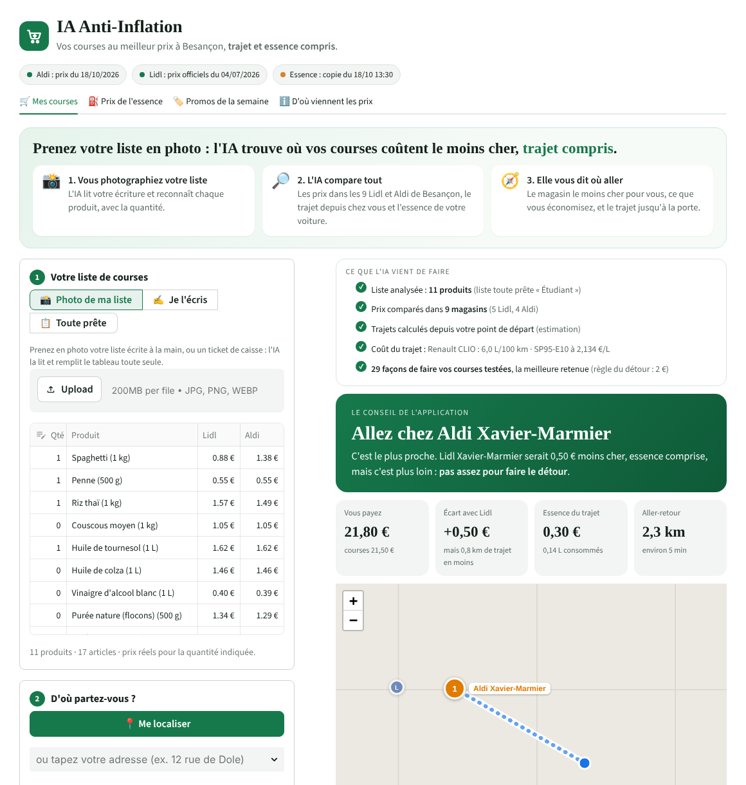

# 🛒 IA Anti-Inflation · Besançon

**Où faire mes courses moins cher, trajet et essence compris : Lidl ou Aldi ?**

L'application compare votre liste de courses dans **les 9 magasins Lidl et Aldi de Besançon**, avec de **vrais prix**,
calcule le **vrai trajet** depuis l'endroit où vous êtes, ce que votre voiture va **consommer** et ce que coûte
**l'essence à votre station**, puis vous dit où aller et vous y guide, comme un GPS.



---

## Deux versions

| Fichier | Pour qui | Ce qu'on voit |
|---|---|---|
| `app.py` | **Le consommateur** | 3 questions (ma liste en photo, d'où je pars, comment j'y vais), puis la réponse : « Va chez… », le prix total trajet compris, l'économie, la carte et le bouton GPS |
| `app_complet.py` | **La présentation** (jury, professeure) | Tout le détail : comparaison des options, prix de l'essence station par station, promos, sources |

Pour mettre la version complète en ligne aussi : sur share.streamlit.io, **Create app**, même dépôt, fichier `app_complet.py`.

## Ce que fait l'application

| | |
|---|---|
| 📍 **Vous localise** | Bouton « Me localiser » (GPS du téléphone), recherche d'adresse avec suggestions, ou choix d'un quartier |
| 📸 **Lit votre liste en photo** | Photo de la liste écrite à la main (ou d'un ticket de caisse) : l'IA la lit et remplit le panier toute seule. On peut aussi l'écrire au clavier |
| 🚗 **Connaît votre voiture** | Marque, modèle, motorisation : consommation officielle en ville (ADEME). Électrique, à pied, vélo, bus aussi |
| ⛽ **Prix de l'essence en direct** | Prix déclarés par chaque station autour de vous, actualisés toutes les 10 minutes |
| 🏷️ **Vrais prix Lidl et Aldi** | Collectés automatiquement sur les sites des enseignes (voir plus bas) |
| 🧮 **Calcule le meilleur plan** | Un seul magasin, ou deux si le détour vaut le coup, essence comprise |
| 🗺️ **Vous guide** | Trajet sur la carte, instructions étape par étape, boutons Google Maps et Waze |
| 📊 **Montre tout** | Litres consommés, coût du trajet, économie par an, prix produit par produit |

**La règle du détour.** L'application part du magasin **le plus proche**. Elle ne vous envoie plus loin, ou dans
un deuxième magasin, que si cela fait gagner **au moins 2 €** (réglable). Ce seuil sera fixé grâce au questionnaire
mené auprès des consommateurs de Besançon.

## D'où viennent les données

| Donnée | Source | Fraîcheur |
|---|---|---|
| Prix **Aldi** | Fiches produits publiques d'aldi.fr | Collecte automatique **chaque jour** |
| Prix **Lidl** | Document officiel « Liste des produits comparés » publié par Lidl (prix nationaux) | Vérifié **chaque jour**, mis à jour quand Lidl publie |
| **Promos** Lidl | Page publique « Alimentation & Boissons » de lidl.fr | Chaque jour |
| **Essence** | Ministère de l'Économie, flux instantané des prix des carburants (data.economie.gouv.fr) | **En direct**, toutes les 10 min |
| **Consommation** des voitures | ADEME, Car Labelling (valeurs WLTP basse et moyenne vitesse) | Données officielles |
| **Magasins**, cartes | OpenStreetMap · fond de carte CARTO | — |
| **Itinéraires** | OSRM, sur les routes d'OpenStreetMap | En direct |
| **Adresses** | Géoplateforme IGN (Base Adresse Nationale) | En direct |
| **Lecture des photos** | IA Claude (Anthropic), modèle qui lit l'écriture manuscrite | À chaque photo |

> **Bon à savoir.** Lidl ne vend pas d'alimentaire en ligne : son site ne montre pas le prix de ses produits du
> quotidien. La seule source publique est le document que Lidl publie pour sa publicité comparative, avec le prix
> national de ~50 produits. Les prix Lidl ont donc la date des relevés de Lidl (affichée dans l'application).

## Le robot de collecte

Le dossier `collecte/` contient le robot qui lit les prix. Il est conçu pour être **respectueux** :

- il lit et **respecte le fichier robots.txt** de chaque site (une page interdite n'est jamais lue) ;
- il fait une **pause de 3 secondes** entre deux pages et passe **une fois par jour** : les prix en magasin changent
  au plus une fois par semaine, il est inutile de solliciter les sites plus souvent ;
- il ne lit que des **pages publiques**, sans compte, sans contourner aucune protection ;
- si un site change ou ne répond pas, **les derniers prix sont conservés**.

La collecte tourne toute seule grâce à **GitHub Actions** (`.github/workflows/collecte-prix.yml`) : chaque matin,
le robot met à jour `data/prix_aldi.json`, `data/prix_lidl.json` et `data/promos_lidl.json`, et l'application
en ligne se met à jour automatiquement. On peut aussi la lancer à la main :

```bash
pip install -r requirements-collecte.txt
python -m collecte
```

Pour comparer ce qui est comparable, chaque produit est ramené à la même quantité : si un magasin ne vend que des
paquets de 500 g, on compte deux paquets pour 1 kg (`data/panier.csv`).

## Organisation du code

```
ia-anti-inflation/
├── app.py                      # version consommateur, épurée
├── app_complet.py              # version détaillée pour la présentation
├── moteur/
│   ├── optimiseur.py           # la décision : meilleur plan, règle du détour
│   ├── geo.py                  # itinéraires routiers, instructions GPS en français
│   ├── carburant.py            # prix de l'essence en direct
│   ├── vehicules.py            # consommation des voitures (ADEME)
│   ├── localisation.py         # recherche d'adresse, position GPS
│   ├── scan.py                 # lecture de la liste en photo (IA) ou au clavier
│   ├── donnees.py              # catalogue de produits et prix
│   └── liens.py                # liens Google Maps et Waze
├── collecte/
│   ├── navigateur.py           # accès poli aux sites (robots.txt, pauses)
│   ├── aldi.py                 # lecture des fiches produits Aldi
│   ├── lidl.py                 # lecture du document de prix Lidl et des promos
│   └── __main__.py             # lance toute la collecte
├── data/                       # magasins, prix collectés, panier, véhicules, copie de secours essence
├── tests/                      # 25 tests automatiques
└── .github/workflows/          # collecte automatique quotidienne
```

## Lancer l'application sur son ordinateur

```bash
pip install -r requirements.txt
streamlit run app.py
```

Tests : `pip install pytest` puis `pytest`.

## Mettre l'application en ligne (gratuit)

1. Déposer ce dossier sur GitHub (dépôt public).
2. Sur [share.streamlit.io](https://share.streamlit.io) : se connecter avec GitHub, **Create app**, choisir ce dépôt
   et `app.py`, puis **Deploy**. On obtient un lien en `…streamlit.app`.
3. Pour la collecte automatique : dans le dépôt GitHub, onglet **Actions**, activer les workflows. Le bouton
   **Run workflow** lance une collecte tout de suite.

> La localisation par GPS ne fonctionne qu'en **https** : c'est le cas sur Streamlit Cloud.

## Activer la lecture des listes en photo (IA)

La lecture des photos utilise l'IA Claude d'Anthropic. Il faut une clé, à créer une seule fois :

1. Créer un compte sur [platform.claude.com](https://platform.claude.com), ajouter quelques euros de crédit,
   puis créer une **clé d'API** (elle commence par `sk-ant-`).
2. Sur Streamlit Cloud : votre application → **Settings** → **Secrets**, et coller :
   ```toml
   ANTHROPIC_API_KEY = "sk-ant-..."
   ```
3. Enregistrer : le bouton « Lire ma liste avec l'IA » apparaît.

Le modèle utilisé par défaut est `claude-haiku-5-5`, rapide et peu coûteux : une photo coûte moins d'un centime.
Pour un autre modèle, ajouter `ANTHROPIC_MODEL = "claude-sonnet-5-5"` dans les Secrets. Ne jamais mettre la clé
dans le code ni sur GitHub. Sans clé, l'application fonctionne : la liste peut être écrite au clavier.

## Limites actuelles

- Deux enseignes (Lidl et Aldi) et 21 produits comparables dans les deux magasins.
- Prix Lidl : ceux que Lidl publie, à la date de ses relevés.
- Si les sites des enseignes bloquent les serveurs de GitHub, la collecte peut être lancée depuis un ordinateur
  personnel avec `python -m collecte`.

## Prochaines étapes

1. Ajouter d'autres enseignes de Besançon et plus de produits.
2. Envoi des prix lus sur les tickets de caisse pour enrichir la base (Carrefour, Leclerc…).
3. Test avec 30 utilisateurs à Besançon.

---

**Mohamed-Aziz Zaanoun** · Statut national étudiant-entrepreneur, Pépite BFC · Besançon, 2026
Données : © contributeurs OpenStreetMap (ODbL), CARTO, ADEME, Ministère de l'Économie (Licence Ouverte), prix publiés par Lidl et Aldi.
